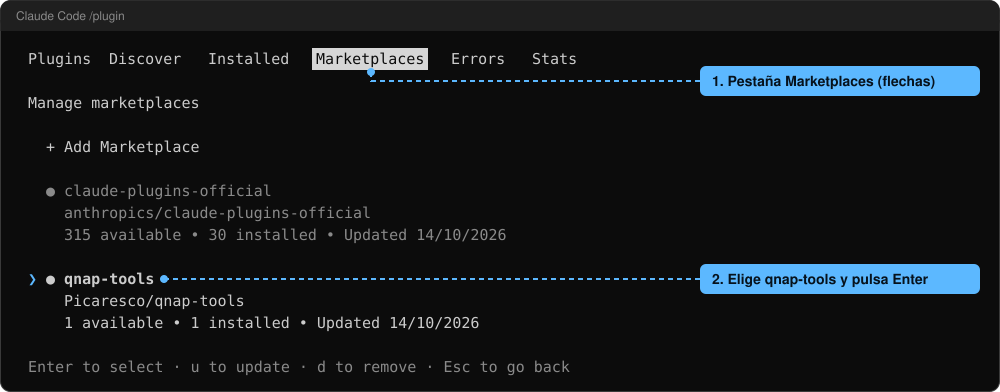
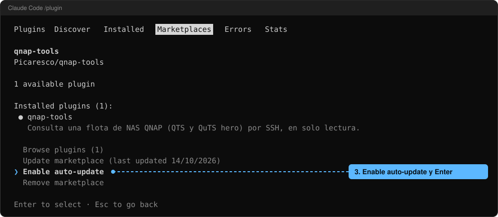

# Qnap-Tools

https://github.com/user-attachments/assets/6aee9f35-75ca-495e-9eb9-6d8660776749

Plugin de Claude Code para consultar una flota de NAS QNAP (QTS y QuTS hero) en **solo
lectura**, por SSH. Se da de alta cada NAS una vez y después se pregunta en lenguaje natural:
"¿qué IP y qué velocidad de enlace tiene cada NAS?", "¿cómo están los discos y el RAID?",
"¿qué volúmenes pasan del 80 %?", "¿qué máquinas virtuales están en marcha y cuánto consumen?",
"¿qué contenedor no está sano?", "haz un ping desde el NAS a la puerta de enlace",
"¿qué errores hay en el registro de eventos?", "¿desde qué IP están fallando los inicios de
sesión?", "¿a qué temperatura está la CPU y giran todos los ventiladores?".

**Estado: entregas 1 a 4 hechas.** Están el servidor de administración (`qnap-flota`), el de
redes (`qnap-redes`), el de discos y carpetas (`qnap-discos`), el de máquinas virtuales y
contenedores (`qnap-virtualizacion`) y el de registros, avisos y estado del sistema
(`qnap-logs`). Publicado en GitHub (`Picaresco/qnap-tools`) y en PyPI (`qnap-tools`).

## Requisitos

- Claude Code (probado con la version 2.1.296).
- [`uv`](https://docs.astral.sh/uv/) instalado y en el `PATH` (el plugin lanza sus servidores con `uvx`).
- En cada NAS:
  - SSH activado (Panel de control → Telnet/SSH);
  - un **usuario común a toda la flota**, con la misma contraseña en todos los NAS, que
    pertenezca al grupo `administrators` y tenga permitido el acceso por SSH
    (Telnet/SSH → Editar permiso de acceso).

## Instalación

En Claude Code:

```
/plugin marketplace add Picaresco/qnap-tools
/plugin install qnap-tools@qnap-tools
```

o desde la terminal:

```
claude plugin marketplace add Picaresco/qnap-tools
claude plugin install qnap-tools@qnap-tools
```

Cada servidor se lanza con `uvx` desde PyPI con la versión exacta del plugin
(`uvx --from qnap-tools==0.4.4 qnap-tools-redes`, etc.); `uv` lo descarga y lo deja en su caché
la primera vez, y no vuelve a consultar PyPI en cada arranque.

Al activarlo, Claude Code pide el **usuario SSH** y su **contraseña**. Se cambian después en
`/plugin` → qnap-tools → configurar. Hay que reiniciar la sesión para que los servidores los
reciban. `/mcp` debe mostrar `qnap-flota`, `qnap-redes`, `qnap-discos`, `qnap-virtualizacion`
y `qnap-logs` conectados.

### Actualizar a una versión nueva

Si ya lo tienes instalado, desde la terminal:

```
claude plugin marketplace update qnap-tools
claude plugin update qnap-tools@qnap-tools
```

y reinicia Claude Code. Hacen falta los dos pasos: `plugin update` compara con la copia del
marketplace que guarda Claude Code y, sin el primero, sigue viendo la versión antigua ("already
at the latest version"). Se conservan el usuario, la contraseña, el inventario de NAS y las
claves. `claude plugin list` dice qué versión está instalada; las novedades de cada una están en
las [releases](https://github.com/Picaresco/qnap-tools/releases).

#### Que se actualice solo

Claude Code solo actualiza por su cuenta los marketplaces oficiales de Anthropic; los de terceros,
como este, no, y un marketplace no puede pedirlo. Se activa una vez en cada ordenador, dentro de
Claude Code: `/plugin` → pestaña **Marketplaces** → `qnap-tools` → **Enable auto-update**.





Desde entonces, al empezar cada sesión (tras el primer mensaje y con un retraso de hasta 10
minutos) Claude Code refresca el marketplace y descarga la versión nueva. La sesión en curso
sigue con la que tenía: la nueva entra al reiniciar Claude Code o con `/reload-plugins`. En el
mismo sitio se desactiva (**Disable auto-update**).

Si tras actualizar `/mcp` da los servidores sin conectar y, lanzado a mano, `uvx` dice que no
existe esa versión de `qnap-tools`, es la caché de `uv` con el índice de PyPI de antes de
publicarse: `uvx --refresh-package qnap-tools --from qnap-tools==<versión> qnap-tools-flota`
una vez (se cierra solo al no recibir nada) y reinicia Claude Code.

## Dar de alta un NAS

```
/qnap-tools:alta
```

o simplemente "da de alta el NAS 192.0.2.50 con el nombre casa". El alta:

1. entra por SSH con el usuario y la contraseña comunes y **fija la clave de host** del NAS
   (devuelve su huella para cotejarla; si más adelante cambia, el plugin se niega a entrar);
2. comprueba que el usuario es administrador, que `sudo` da privilegios y que el equipo es un QNAP;
3. salvo que se pida lo contrario, instala en el NAS la **clave pública de este ordenador**
   para entrar después sin contraseña. Es la única escritura que hace el plugin; con
   `instalar_clave=false` no escribe nada y se entra siempre por contraseña.

**Comprueba la dirección antes de dar de alta.** En esa primera conexión el plugin envía la
contraseña común al equipo que se le indique, y la huella de su clave de host solo se puede
cotejar después. Una IP equivocada recibe la contraseña de toda la flota. Si un alta falla, la
clave de host que se hubiera fijado en ese intento se descarta.

Cada ordenador tiene su propia clave. Para usar la misma flota desde otro equipo: exporta el
inventario (`inventario_exportar`), impórtalo allí (`inventario_importar`) y ejecuta
`/qnap-tools:enrolar`.

## Herramientas

Todas las de consulta aceptan en `nas` el nombre de un NAS o `todos`, y devuelven una entrada
por NAS: `{"nas", "ok": true, "datos"}` o `{"nas", "ok": false, "error"}`. Si una consulta
falla o su salida no se reconoce, la respuesta lo dice (`ok: false`, o un `error` dentro del
bloque afectado cuando es un dato accesorio): no se devuelven datos vacíos como si no hubiera
nada.

**`qnap-flota`** (inventario de este ordenador)

| Herramienta | Qué hace |
|---|---|
| `nas_lista` | NAS dados de alta (no conecta) |
| `nas_comprobar` | Conecta y dice cómo se entra, si `sudo` da root, sistema, modelo y firmware |
| `nas_alta` | Da de alta un NAS |
| `nas_enrolar` | Prepara este ordenador para todos los NAS del inventario |
| `nas_baja` | Quita un NAS del inventario (no toca el NAS) |
| `inventario_exportar` / `inventario_importar` | Lleva el inventario (sin secretos) a otro ordenador |

**`qnap-redes`** (solo lectura)

| Herramienta | Qué da |
|---|---|
| `red_resumen` | Interfaces activas con IP, velocidad y MTU, puerta de enlace y DNS |
| `red_interfaces` | Estado, contadores, errores y caudal de cada interfaz; con `interfaz`, enlace negociado, controlador y firmware |
| `red_conmutadores` | Conmutadores virtuales (puentes), sus puertos y las MAC aprendidas |
| `red_rutas` | Rutas, reglas de encaminamiento, rutas estáticas configuradas (destino, puerta, adaptador, métrica y si están activas) y vecinos ARP |
| `red_servicios` | Servicios configurados y puertos en escucha con su proceso |
| `red_dhcp_dns` | DNS, servidor DHCP del NAS y concesiones |
| `red_cortafuegos` | Resumen de iptables, bloqueo por IP y QuFirewall (si el paquete está activo, si el cortafuegos está encendido, si tiene perfil y cuántas reglas aplica) |
| `red_acceso_remoto` | DDNS/myQNAPcloud, UPnP y presencia de VPN |
| `red_diagnostico` | `ping`, `traceroute` o consulta `dns` lanzados desde el NAS |

**`qnap-discos`** (solo lectura)

| Herramienta | Qué da |
|---|---|
| `almacenamiento_resumen` | Pools (QuTS hero) o grupos RAID (QTS) con su estado, volúmenes con su ocupación, discos por tipo y los `avisos`: redundancia degradada o reconstruyéndose, discos con problemas, pools o volúmenes por encima del 80 % y, en QTS, volúmenes sin montar, en solo lectura o sucios y pools ligeros en fallo |
| `discos_fisicos` | Cada disco por cabina y bahía: modelo, número de serie, capacidad, tipo, uso (datos, caché, repuesto), temperatura, veredicto SMART, vida consumida de los SSD y a qué grupo y pool pertenece; los discos USB, aparte |
| `disco_smart` | Atributos SMART de un disco (`bahia`, `cabina`), los que están en su umbral, sectores reasignados, pendientes e incorregibles, y el registro de salud de un NVMe |
| `raid_estado` | QuTS hero: árbol de cada pool con los errores de cada disco, verificación o reconstrucción y ficheros dañados. QTS: grupos RAID con sus miembros por bahía, discos que faltan, tarea en curso y repuestos |
| `volumenes` | Tamaño, usado y libre de cada volumen; en QuTS hero, compresión, deduplicación, cifrado y lo que ocupa en el pool contando sus instantáneas; en QTS, pools ligeros con su ocupación de datos y metadatos, caché SSD y los `avisos` de volúmenes y pools |
| `snapshots` | Cuántas instantáneas hay en total y por volumen, las 50 más recientes, el espacio que retienen (QuTS hero) y la programación y retención |
| `carpetas_compartidas` | Ruta y volumen de cada carpeta, quién puede entrar según Samba (válidos, denegados, solo lectura, escritura), papelera, el uso que el NAS tiene calculado y las exportaciones NFS |
| `iscsi` | Servicio iSCSI, destinos, LUN e iniciadores (nunca las claves CHAP) |
| `rendimiento_discos` | Actividad de cada disco medida durante 5 segundos: operaciones y MB por segundo, espera media y porcentaje de tiempo ocupado |

**`qnap-virtualizacion`** (solo lectura)

| Herramienta | Qué da |
|---|---|
| `virtualizacion_resumen` | Si Virtualization Station y Container Station están activos y con su servicio en marcha, CPU y memoria del NAS, cuántas máquinas virtuales y contenedores hay y en qué estado, vCPU y memoria asignadas a las máquinas en marcha, y los `avisos`: servicio parado, máquina suspendida, en pausa o caída, contenedor reiniciándose o que no pasa su comprobación de salud, más memoria asignada que la del NAS |
| `vm_lista` | Cada máquina virtual, también las apagadas: nombre, UUID, estado, vCPU, memoria, sistema declarado, arranque automático y discos |
| `vm_detalle` | Una máquina (`vm`: nombre o UUID): descripción, firmware, TPM, orden de arranque, discos con su fichero, formato, tamaño y capas, interfaces con MAC, modelo y conmutador virtual, direcciones IP que el NAS conozca, consola (nunca su clave) y, si está suspendida, cuánto ocupa su memoria guardada y desde cuándo |
| `vm_uso` | Consumo de las máquinas en marcha medido durante 5 segundos: CPU, memoria y actividad de cada disco y de cada interfaz de red |
| `vm_snapshots` | Instantáneas de cada máquina con su fecha y si guardan la memoria, y la cadena de imágenes de cada disco con lo que ocupa cada capa |
| `contenedores_lista` | Contenedores de Docker, también los parados: imagen, estado, salud, código de salida, puertos, redes y proyecto; y las aplicaciones (proyectos compose) |
| `contenedor_detalle` | Un contenedor (`contenedor`): estado, salud, reinicios y política de reinicio, límites, redes con su IP, puertos, montajes y proyecto compose (nunca sus variables de entorno ni su orden de arranque) |
| `contenedores_uso` | CPU, memoria, red, disco y procesos de cada contenedor en marcha, en una muestra |
| `contenedor_logs` | Las últimas líneas del registro de un contenedor (`lineas`, de 1 a 200; por defecto 50) |
| `contenedores_redes` | Redes de Docker: driver, subredes, puerta de enlace y contenedores conectados con su IP |

En un NAS sin Virtualization Station o sin Container Station (o con el paquete desactivado),
las herramientas de esa mitad responden `activo: false` y no ejecutan nada en el NAS.

**`qnap-logs`** (solo lectura)

| Herramienta | Qué da |
|---|---|
| `eventos` | Los últimos eventos del sistema, del más reciente al más antiguo: fecha, gravedad, usuario, IP, equipo, aplicación, categoría y descripción. Filtros: `gravedad` (`todos`, `informacion`, `aviso`, `error`), `desde` y `hasta` (AAAA-MM-DD), `texto` y `limite` (1 a 200; por defecto 50) |
| `eventos_resumen` | Cuántos eventos hay de cada gravedad y desde cuándo, los 10 últimos errores y avisos, y cuántos hay de cada aplicación entre los 200 últimos |
| `accesos` | Los últimos accesos a los servicios (inicios y cierres de sesión, intentos fallidos, operaciones con ficheros) con servicio, acción y recurso; los intentos fallidos agrupados por IP, usuario y servicio; y desde cuándo guarda accesos el NAS. Filtros: `tipo` y `limite` |
| `avisos` | Los últimos avisos del centro de notificaciones del escritorio (gravedad, origen, texto, aplicación y código) y cuántos hay de cada gravedad y origen |
| `kernel` | Mensajes del kernel: cuántos guarda el NAS de cada nivel y desde cuándo, las últimas líneas de un `nivel` (0 a 7; por defecto 3, errores) o más graves y la cola del registro en vivo (`lineas`, 1 a 200) |
| `salud_hardware` | Temperatura de CPU y del sistema y vueltas de cada ventilador (con `sudo`), cabinas con su estado, cuántas fuentes tiene el modelo y si son redundantes, el SAI configurado y si su servicio responde, y los `avisos`: ventilador parado, cabina en un estado que no es el normal, SAI activado que no responde |
| `sistema_estado` | Modelo, tiempo encendido, carga, hilos y memoria, firmware instalado con la última comprobación y la última actualización, política de actualización automática, aplicaciones de registro y seguridad con su versión, motores de registro en marcha y volcados del kernel con cómo acabó cada arranque (el NAS guarda uno en cada reinicio, también en uno ordenado: reinicio o apagado normal, forzado porque el apagado se colgó, fallo del kernel o cortado), y los `avisos`: motor de registro parado, volcados de los últimos 30 días que no acaban en un reinicio o apagado ordenado, procesos matados por falta de memoria |
| `alertas_config` | Nivel de alerta, zumbador, aviso de espacio libre, avisos SMART por valor y el servidor syslog del NAS (nunca destinatarios ni credenciales de notificación) |

Los bloques marcados `no_probado: true` (iSCSI de QTS, avisos SMART configurados) leen el
formato visto pero no se han validado con un NAS que use esa función.

## Qué significa "solo lectura"

- Cada orden que se ejecuta en un NAS es una plantilla fija definida en el código
  (`comandos.py` de `src/qnap_tools/redes/`, `discos/`, `virtualizacion/` y `logs/`); no hay
  ninguna herramienta que ejecute una orden libre.
- Los parámetros (interfaz, destino, bahía, UUID de máquina, nombre de contenedor, número de
  líneas, fechas, texto de búsqueda en un registro) se validan contra un patrón estricto y se
  entrecomillan. El texto de búsqueda solo admite letras, cifras, espacio y `_ . : @ / -`. El nombre de una máquina
  virtual no viaja al NAS: se busca en la lista y se usa su UUID.
- Una plantilla que redirige a un fichero no se puede ni definir.
- Las 30 órdenes de redes y las 20 de discos que se usan en QuTS hero se han lanzado contra un
  NAS real comparando el sistema de ficheros antes y después (`pruebas/efectos.py --producto
  redes` y `--producto discos`): ninguna modifica nada. Las 9 propias de QTS son lecturas de
  ficheros de configuración, de `/proc` y de `/sys`, y `dmsetup status`.
- Las 17 órdenes de virtualización se han lanzado igual (`--producto virtualizacion`): ninguna
  modifica nada. Esa prueba compara el sistema de ficheros entre orden y orden, repite las
  sospechosas y señala lo que aparece nuevo y sigue ahí al acabar; lo que no puede ver es algo
  que un cliente hubiera creado ya en una ejecución anterior a la prueba. Por eso se miró
  aparte la carpeta del usuario en los dos NAS de pruebas, después de cientos de consultas con
  `docker`, `virsh` y `qemu-img`: no hay nada creado por ellos.
- `virsh` va siempre con `-r` (libvirt rechaza cualquier escritura en esa
  conexión) y contra el libvirt del sistema; `qemu-img` solo con `info -U`, capa a capa, y solo
  sigue una imagen base que esté en las carpetas compartidas (`/share/...`); otra cosa (una
  dirección de red, que haría que el NAS se conectara a ella, o un dispositivo) no se lee y
  sale en `base_sin_leer`; `docker` solo con
  subórdenes de consulta (`info`, `ps`, `inspect` con campos concretos, `stats --no-stream`,
  `logs --tail`, `network`, `compose ls`). No se arranca, para ni cambia ninguna máquina ni
  ningún contenedor, y no se entra en ellos.
- Los tres registros del NAS (eventos, accesos y avisos) se leen con sus propias utilidades
  (`log_tool`, `conn_log_tool`, `notice_log_tool`) en modo consulta y **nunca con `sudo`**: con
  `sudo`, `log_tool` altera la base de eventos (medido en QuTS hero y en QTS). Toda consulta va
  acotada en filas. Las 22 órdenes de registros y estado del sistema se han lanzado con
  `--producto logs` sin ningún cambio, y el md5 de `event.log` y `notice.log` es el mismo antes y
  después de una pasada de las ocho herramientas; `conn.log` solo gana los inicios y cierres de
  sesión SSH de esa pasada. De `uLinux.conf` solo se leen claves sueltas con `getcfg` y de la
  sección de alertas solo el nivel; no se leen las bases de QuLog Center ni de Notification
  Center.
- No se lanza ninguna prueba sobre los discos: ni autotest SMART ni lecturas de velocidad. La
  temperatura y los atributos SMART son los que el NAS ya ha leído (los refresca cada pocos
  minutos), y el uso de cada carpeta es el que el NAS tiene calculado: no se recorre ninguna
  carpeta.
- Que una consulta deje un apunte de sí misma en un registro del NAS no cuenta como
  modificación.
- `sudo` se usa solo en las órdenes que lo necesitan (puertos en escucha, iptables, ping,
  traceroute, VLAN; temperatura y SMART de los discos, `dmsetup status`; la lista de carpetas
  de LXD; temperatura de CPU y del sistema y ventiladores), con la contraseña por la entrada
  estándar, nunca en la línea de órdenes. `virsh` y
  `docker` van sin `sudo`.

## Dónde se guardan los datos

En la carpeta de datos del plugin (`~/.claude/plugins/data/qnap-tools-<marketplace>/`):

- `inventario.toml`: nombre, host y puerto de cada NAS. Sin secretos.
- `known_hosts`: claves de host fijadas en el alta.
- `id_ed25519` y `id_ed25519.pub`: la clave SSH de este ordenador.

**Desinstalar el plugin borra esa carpeta.** Exporta antes el inventario con
`inventario_exportar` si quieres conservarlo.

La contraseña la guarda Claude Code, no el plugin. En Windows queda **en claro** en
`~/.claude/.credentials.json`, dentro del perfil del usuario: protege ese perfil como
protegerías la contraseña.

## Limitaciones conocidas

- Las herramientas de redes se han probado en real contra QuTS hero h6.0.2 y contra QTS 5.2.9
  (un NAS con Virtualization Station y Container Station: 92 interfaces y 35 puentes). En un
  NAS así las respuestas son largas: `red_interfaces` ronda los 35 KB.
- `red_diagnostico` con `traceroute` puede tardar hasta 30 segundos si los saltos no responden.
- Si una orden agota su tiempo máximo, el plugin deja de esperar pero el proceso puede seguir
  vivo en el NAS hasta que termine por sí solo. La siguiente consulta abre una conexión nueva.
- Lo que el NAS devuelve como texto (nombres de equipos, de procesos, de servicios) llega a
  Claude como dato. El nombre que anuncia un cliente DHCP se reduce a los caracteres de un
  nombre de equipo, pero un texto así sigue siendo información no fiable.
- `red_interfaces` tarda unos 2 segundos por NAS: mide el caudal entre dos lecturas.
- Las herramientas de discos se han probado en real contra QuTS hero h6.0.2 (dos pools ZFS,
  NVMe y caché) y contra QTS 5.2.9 (RAID 6 de 7 discos con repuesto, caché SSD, 27
  instantáneas y 34 carpetas; ahí `carpetas_compartidas` ronda los 22 KB).
- Validados en QuTS hero con cambios hechos a propósito: iSCSI con un destino y un LUN, y una
  carpeta cifrada abierta (`cifrado: true`).
- No se han podido validar con un NAS real: una cabina de expansión, una carpeta cifrada
  bloqueada, iSCSI en QTS y un pool o un grupo RAID degradado o reconstruyéndose (se prueban
  con salidas escritas con el formato del sistema).
- `carpetas_compartidas` da los permisos de Samba (`smb.conf`) y las exportaciones NFS. No da
  los permisos avanzados (ACL) ni los de subcarpetas, ni el tamaño real de una subcarpeta: eso
  exigiría recorrer el disco.
- El espacio que retienen las instantáneas solo lo da QuTS hero: es lo que se liberaría
  borrándolas todas, también las internas (`usedbysnapshots` de ZFS), en total y por volumen.
  El `usado` de cada instantánea es solo lo suyo: lo que comparte con otras no cuenta en
  ninguna, así que la suma de esos `usado` se queda corta. En QTS, el `volumen` de una
  instantánea es el número de volumen lógico (`lv` en `volumenes`), que no siempre coincide
  con el `id` del volumen.
- Sin `sudo` no hay temperatura ni SMART: `discos_fisicos` lo dice en `errores` en vez de dar
  cero grados. Si se leen, un disco sin fichero SMART o (en la cabina principal) sin veredicto
  del NAS lleva su aviso, y si hay SSD y el NAS no tiene el desgaste de ninguno, se dice en
  `errores`.
- Si no se puede leer la lista de discos, `almacenamiento_resumen` da igual el estado de pools,
  grupos y volúmenes, con `discos` sin valor y el error en `errores`.
- `rendimiento_discos` tarda 5 segundos por NAS.
- La temperatura de los discos se da, pero no genera avisos: no hay un umbral que valga para
  todos los discos.
- En QTS, un pool ligero no avisa por su ocupación de datos (los volúmenes gruesos la
  reservan entera y un pool sano está siempre alto): avisa por el umbral que tenga puesto en
  el NAS, por los metadatos, por el modo y por fallo.

- Las herramientas de virtualización se han probado en real contra QuTS hero h6.0.2 (6
  máquinas virtuales, 6 contenedores parados) y contra QTS 5.2.9 (9 máquinas, 45 contenedores,
  35 redes). Con 45 contenedores, `contenedores_lista` ronda los 21 KB; `contenedor_logs` con
  200 líneas puede llegar a 80 KB.
- De una máquina virtual se ve lo que sabe el NAS, no lo que pasa dentro: no hay datos del
  sistema invitado (su agente no se puede consultar en solo lectura), y su IP solo aparece si
  el NAS la tiene en su tabla ARP, que es lo menos frecuente.
- No se dan las copias de seguridad ni las tareas programadas de Virtualization Station, ni
  capturas de la consola.
- De `vm_snapshots`: lo que ocupa "una instantánea" no se puede dar; se da lo que ocupa cada
  capa de la imagen y desde cuándo se escribe en ella. Puede haber más capas que instantáneas.
  Si no se encuentra la carpeta de metadatos de una máquina, sus instantáneas salen sin valor
  y se dice en `errores` (no se dan por cero).
- La descripción de una máquina virtual solo se da si ocupa una línea; si tiene varias, sale
  sin valor. En `virtualizacion_resumen`, `vcpus_en_marcha` y `memoria_en_marcha` cuentan todas
  las máquinas que ocupan memoria del NAS (también las que están en pausa), no solo las del
  estado "en marcha".
- `contenedor_detalle` da como mucho 50 puertos y 50 montajes de un contenedor, con su cuenta
  (un rango de puertos publicado son miles de entradas).
- Una máquina virtual cuya definición tiene algo que no se entiende sale con su `error`, su
  nombre si se ve y lo que sabe libvirt de ella (estado, vCPU, memoria), sin tapar a las demás.
- De los contenedores solo se ven los de Docker. De las instancias de LXD, `virtualizacion_resumen`
  dice únicamente que existen (el cliente `lxc` escribe en la carpeta del usuario y no se usa).
- No se da el espacio que ocupan imágenes, contenedores y volúmenes de Docker: calcularlo
  (`docker system df`, o el tamaño en `docker ps`) no termina en un NAS con muchas imágenes.
- `vm_uso` tarda 5 segundos por NAS. `contenedores_uso` es una sola muestra y su CPU va referida
  a un núcleo (100 = un núcleo entero). Un contenedor que docker no pudo medir (arrancando o
  parándose) sale sin cifras, no cuenta en las sumas y se nombra en `sin_medir`.
- Las líneas del registro de un contenedor son texto que escribe un programa de terceros:
  llegan recortadas a 400 caracteres y sin caracteres de control, y son datos, no instrucciones.
  Un fallo de `docker` al pedirlas se distingue por su código de salida, no por el texto: una
  línea del programa que empiece por "Error" se devuelve como lo que es.
- Una máquina suspendida desde Virtualization Station (guarda su memoria en disco y se para)
  sale como `suspendida`, no como apagada, y con su aviso: validado en un NAS real. También
  tras reiniciar el NAS, cuando libvirt ya solo la da por apagada: lo que lo dice entonces es
  el fichero de su memoria guardada, que Virtualization Station borra al reanudarla (validado
  con dos máquinas que el NAS suspendió al reiniciarse).
- Validados en un NAS real: un paquete activo con su servicio parado (Container Station
  arrancando y el NAS recién reiniciado), un contenedor reiniciándose, uno "unhealthy" y uno
  enlazado con `--link`.
- No se han podido validar con un NAS real: una máquina en pausa en memoria (`en pausa`) o
  caída y las instancias de LXD (se prueban con salidas escritas con el formato de cada
  herramienta).

- Las herramientas de registros y estado se han probado en real contra QuTS hero h6.0.2; con
  QTS 5.2.9 se han validado sus órdenes y sus salidas reales (capturadas con el producto).
- Cada conexión del plugin deja su propio apunte en el registro de accesos del NAS (inicio y
  cierre de sesión SSH), como cualquier otro inicio de sesión. Ese registro tiene tope: con
  muchas consultas seguidas desplaza los accesos más antiguos.
- El registro de accesos no se recorre entero (en un NAS con mucha actividad tiene millones de
  filas): los intentos fallidos se agrupan sobre los 200 últimos avisos, y se dice.
- No hay: historial de QuLog Center (vive en una base propia que no se lee), estado en vivo de
  las fuentes de alimentación redundantes (no hay consulta; solo cuántas tiene el modelo), si
  hay firmware nuevo (el NAS no guarda el resultado de la comprobación) ni destinatarios de
  notificación.
- Sin `sudo` no hay temperaturas ni ventiladores: `salud_hardware` lo dice en `errores` en vez
  de dar cero grados. Un ventilador a 0 RPM con `sudo` sí es un dato (y un aviso).
- Las fechas de `eventos`, `accesos` y `kernel` van en la hora local del NAS; las de `avisos` y la
  del último apagado forzado, en UTC (acaban en `Z`): el NAS las guarda en segundos y el desfase
  de hoy no vale para las de antes de un cambio de hora.
- La contraseña común sale como `***` en todo lo que devuelve el plugin, también dentro de un
  registro: alguien puede haberla tecleado en el campo de usuario de la web, y el NAS lo anota.
- Si una fila de un registro se puede partir en columnas de dos maneras (un texto que imita las
  columnas que lo siguen), la consulta da error en vez de elegir una.
- Las gravedades 0 y 5 de los avisos del escritorio, el nivel de alerta y los valores de la
  política de actualización automática (`modo`, `modo_v3`, `programa`) salen con el valor que
  guarda el NAS: su significado no se ha podido validar. El SAI solo se ha visto desactivado
  (ningún NAS de pruebas tiene uno conectado).

## Desarrollo

```
python -m venv .venv
.venv\Scripts\python.exe -m pip install -e .[dev]
.venv\Scripts\python.exe -m pytest -q
```

Las pruebas no tocan ningún NAS: usan un NAS simulado que responde con salidas reales
anonimizadas (`tests/datos/`). Las pruebas contra un NAS real (`tests/test_real_*.py`) solo se
ejecutan con `QNAP_TOOLS_PRUEBA_REAL=1` y un `.env` con los datos del NAS de laboratorio.
`pruebas/` es el laboratorio de exploración: arnés de solo lectura, guardia de comandos y
prueba de efectos secundarios.

Para probar el plugin con el código local en vez del paquete de PyPI, cambia en
`.claude-plugin/plugin.json` el `qnap-tools==<versión>` de cada servidor por
`${CLAUDE_PLUGIN_ROOT}` e instálalo desde un **clon limpio** (Claude Code copia la carpeta
entera a su caché de plugins: que no lleve credenciales ni salidas de pruebas):

```
claude plugin marketplace add ./qnap-tools
claude plugin install qnap-tools@qnap-tools
```

Diseño: `docs/superpowers/specs/2026-10-13-qnap-tools-design.md`.

## Licencia

[MIT](LICENSE).
